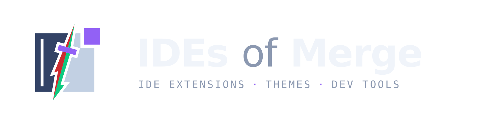

<!-- markdownlint-disable MD033 MD041 -->

<picture>
  <source media="(prefers-color-scheme: dark)" srcset="./idesofmerge-lockup-dark.png">
  <source media="(prefers-color-scheme: light)" srcset="./idesofmerge-lockup-light.png">
  
</picture>

**Perceptually engineered themes, extensions, and developer tools for VS Code, Positron, and modern IDEs.**

---

### Featured Project

| Project | Description | Links |
| --- | --- | --- |
| **[Hylian Palette](https://github.com/IDEsOfMerge/hylian-palette)** | 40th anniversary tribute to *The Legend of Zelda* (1986–2026) — 36 Light & Dark OKLCH themes covering all 18 mainline games for VS Code & Positron, with an offline interactive Workbench & Colorimetry Explorer. | [Repository](https://github.com/IDEsOfMerge/hylian-palette) · [Live Explorer ↗](https://idesofmerge.github.io/hylian-palette/) · [Releases](https://github.com/IDEsOfMerge/hylian-palette/releases) |

### Craft & Engineering Standards

- **Perceptual color science first** — palettes are synthesized in **OKLCH** and audited programmatically against **WCAG 2.1 AA**, **APCA-W3**, **CIEDE2000** (ΔE₀₀), and **Machado et al. (2009)** dichromacy simulation.
- **Zero-dependency & offline-ready** — extensions ship with zero runtime `npm` dependencies and strict zero-CDN Content Security Policies.
- **Reproducible by design** — themes, icons, diagrams, and analytical visualizations are generated deterministically from source tokens and verified in CI on every commit.

---

Publisher ID: <code>idesofmerge</code> · Brand assets &amp; OKLCH color system in <a href="https://github.com/IDEsOfMerge/.github/blob/main/brand/BRAND_GUIDE.md"><code>brand/BRAND_GUIDE.md</code></a>

